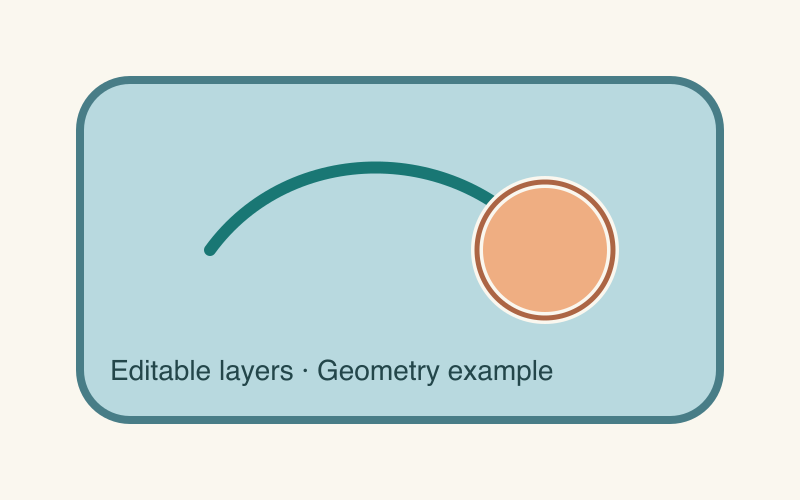

# GZD Vectoriser

An agent skill by **GZDLab** for reconstructing raster diagrams as layered, editable vector graphics.

**Define the construction contract and acceptance evidence; let the agent choose how to draw and repair.** The skill combines difference detection, structural editing probes, independent review, and a persistent repair loop. It does not prescribe drawing recipes for individual shapes.

## What it delivers

- A layered SVG with complete objects, meaningful editing groups, and separately editable text.
- A component asset bundle and an offline slider comparison report.
- Optional native editable PPTX or Illustrator output, when requested and supported by the available environment.
- Optional comparison GIFs or animations that separate and reassemble actual SVG groups.

The included geometry example demonstrates the report format; it is not a reconstruction benchmark or evidence of visual acceptance.



## Install in Codex

Clone the repository into your personal skills directory:

```sh
git clone https://github.com/Shipeng-Guo/gzd-vectoriser.git \
  "${CODEX_HOME:-$HOME/.codex}/skills/gzd-vectoriser"
```

If that directory already exists, preserve the existing installation and compare versions before replacing it. The repository root is the skill folder: it contains `SKILL.md`, `agents/`, `references/`, `scripts/`, and `assets/`.

Invoke the skill with an image or an existing SVG:

```text
Use $gzd-vectoriser to reconstruct this diagram as an editable SVG.
Keep complete objects and meaningful editing groups, run the acceptance
loop, and deliver the SVG, component assets, and comparison report.
```

For a revision, provide the current SVG and describe the intended change. Request PPTX, Illustrator, or animation explicitly when needed. The agent needs local file and tool access; independent acceptance also requires a reviewer with an isolated context.

## How acceptance works

1. Establish requirements from the source image and the user's editing intent.
2. Construct complete objects and render the candidate in source coordinates.
3. Discover differences, preserve issue IDs, and repair each confirmed problem.
4. Test editing behaviour by moving groups, hiding foregrounds, and inspecting underlays.
5. Independently recheck known issues and perform fresh whole-image discovery.
6. Verify that the current artifact, render, and evidence agree before packaging the delivery.

Unresolved issues remain open. Earlier passing results cannot approve a changed artifact, and omission from a later report cannot erase a known issue. Automated gates check evidence and workflow consistency; they do not prove semantic or visual perfection.

Read [SKILL.md](SKILL.md) for the operating contract and [the review interface](references/review-loop.md) for the persistent acceptance loop.

## Runtime requirements

Install dependencies only for the operations you need. The skill does not include model access, a browser, an editor, or the optional presentation runtime.

| Operation | Dependencies |
|---|---|
| Pixel differences, scans, and raster evidence | Python, Pillow, NumPy; OpenCV for the multi-channel scan |
| Optional contour fitting | SciPy, NumPy, OpenCV |
| Browser probes, SVG export, and report checks | Node.js, Playwright, an available Chrome/Chromium; Sharp for relevant rendering operations |
| GIF export | Python and Pillow |
| Native PPTX conversion | Node.js, Playwright, Chrome/Chromium, `@oai/artifact-tool`, and Python |
| Illustrator output | Access to Adobe Illustrator and its applicable automation interface |

The bundled PPTX backend uses the Codex presentation runtime. In Codex, follow the installed Presentations skill to locate that runtime and validate the actual PPTX. Other environments may use a different backend while retaining the same native-object and rendering requirements. Arbitrary SVG-to-PPTX conversion is not lossless; see the [supported subset and limits](references/pptx.md).

An optional local setup for the general Python and browser tools is:

```sh
python3 -m venv .venv
. .venv/bin/activate
python -m pip install pillow numpy opencv-python scipy
npm install --prefix .runtime --no-save --package-lock=false playwright sharp
export NODE_PATH="$PWD/.runtime/node_modules"
```

Use an existing Chrome/Chromium executable with `--browser /path/to/chrome`. See [tools and dependencies](references/tools.md) for operation-specific commands. This setup does not install the optional PPTX runtime or Adobe Illustrator.

## Try the offline report

From the repository root, build the synthetic example into a new directory:

```sh
python3 scripts/build_report.py \
  --manifest assets/comparison-report/example/manifest.json \
  --out output/example-report --draft
```

Open `output/example-report/index.html` in a browser. The explicit draft label is intentional: this example has no bound review ledger. Formal reports require current acceptance evidence.

## Validation and maintenance

After changing review or reporting code, run the relevant regressions. For example:

```sh
cd scripts
python -m unittest -v \
  test_build_report test_review_loop test_independent_review \
  test_exact_difference test_scan_differences test_exact_loop
```

Browser and animation tests take explicit runtime paths; their commands are documented in [report checks](references/report-template.md) and [group animation](references/group-motion.md). Synthetic tests check tool behaviour and failure handling; each real drawing still needs its own visual and structural acceptance.

Keep reusable improvements focused on contracts, difference discovery, evidence handling, and repeated mechanical work. Keep project-specific artwork, coordinates, and repair recipes outside the shared skill.

## Project

Maintained by [GZDLab / Shipeng-Guo](https://github.com/Shipeng-Guo). The current skill version is recorded in [SKILL.md](SKILL.md).
